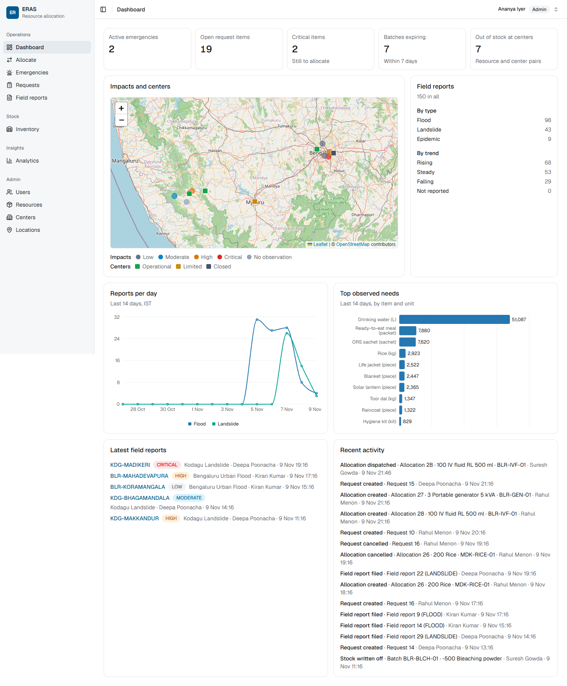
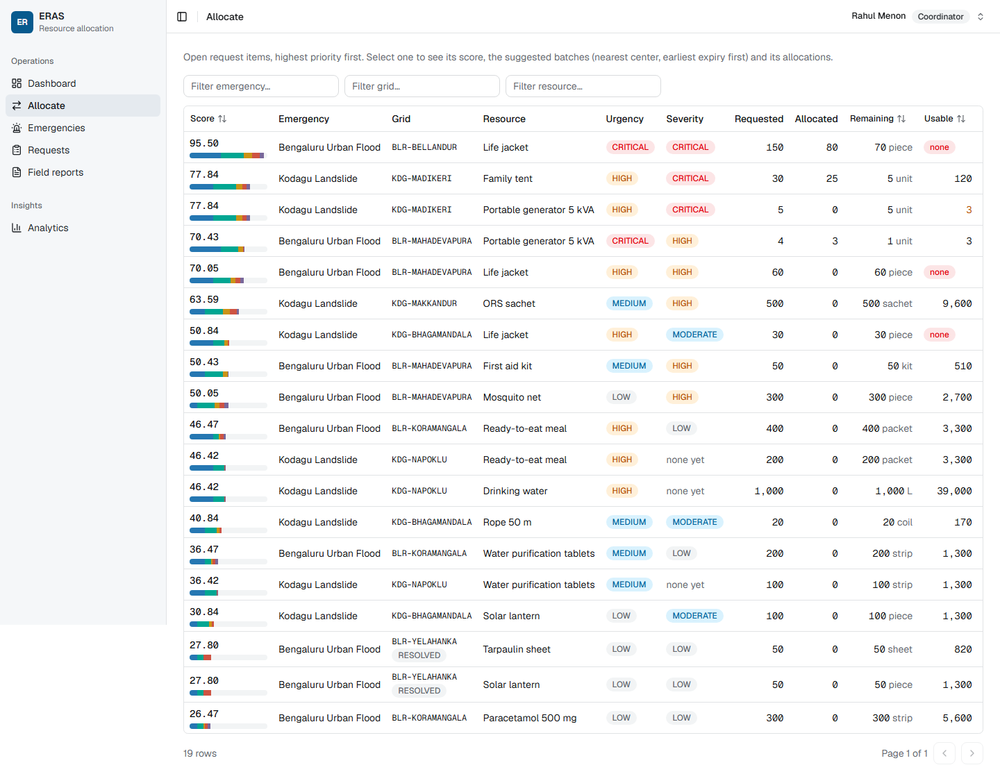
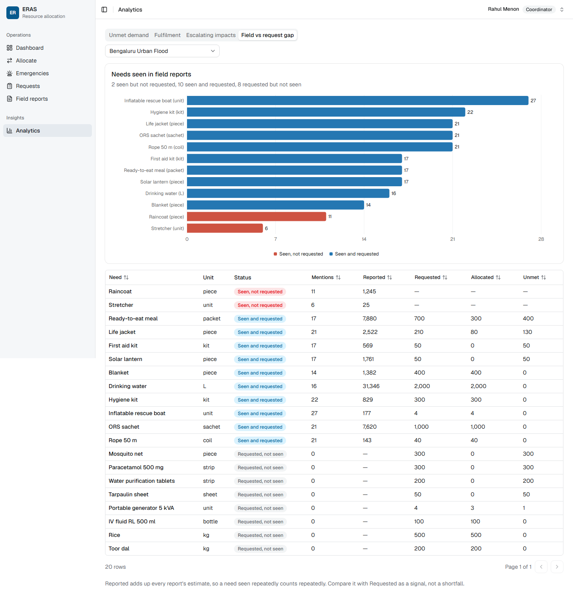
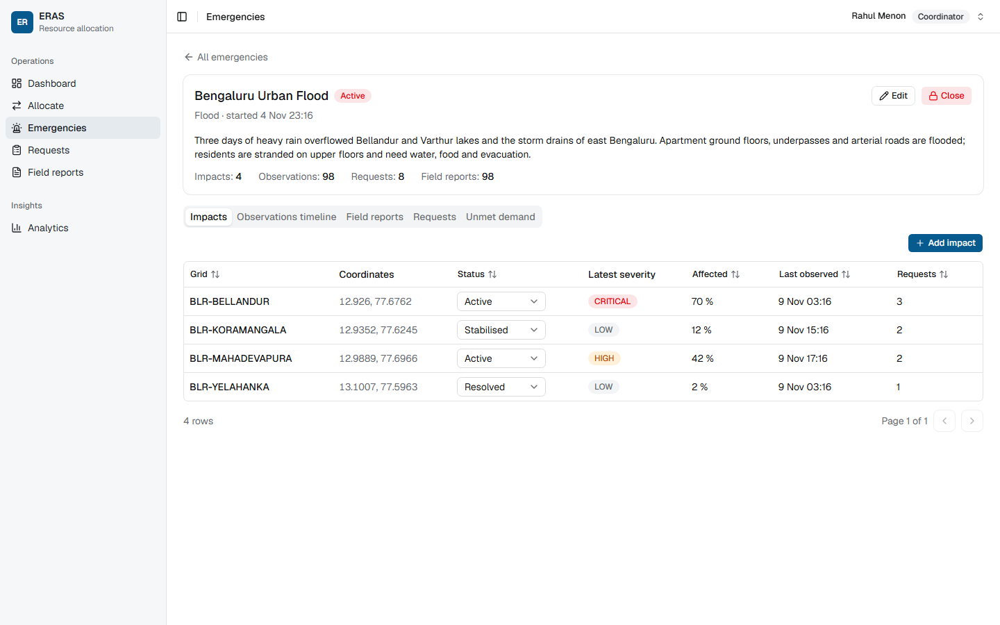
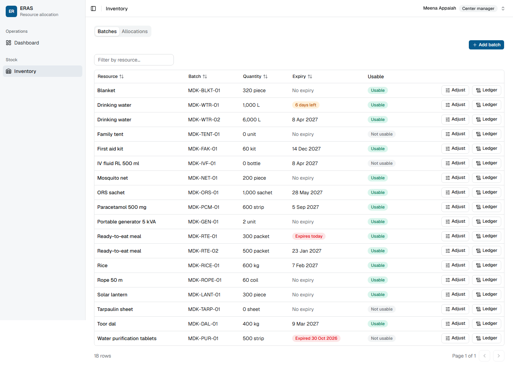
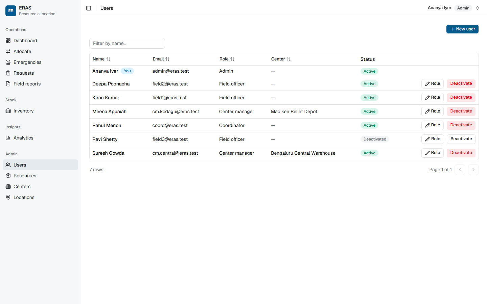

# ERAS — Emergency Resource Allocation System

DBMS Level 3 mini project (UE24CS351A) · Yadunandana Reddy M (PES2UG24CS605) · Vismay Chandra Dev (PES2UG24CS597)

In an emergency, coordinators get more requests than they have stock for. ERAS records emergencies, the places they hit and the requests coming from those places, then ranks every open item with an explainable priority score. It allocates specific batches first-expiry-first-out from the nearest open center, so two coordinators racing for the last units can't oversell.

## Features by role

**Coordinator**
- Create and edit emergencies, add their impacted locations and close them.
- Work the priority queue on `/allocate`: each item's score broken into its parts, batch suggestions, splitting across batches, cancelling.
- File and cancel requests, and search them.
- Analytics: unmet demand, fulfilment by emergency, escalating impacts, and the gap between needs seen in field reports and what was actually requested.

**Field officer**
- View emergencies and their impacts.
- File requests and see their own.
- File field reports, whose details change with the emergency type, from an impact or a point on the map.
- Search reports by text or near a location.

**Center manager**
- Work on their own center only: batches with expiry and usable badges, receive stock, adjust it with a reason, read a batch's ledger, dispatch and deliver allocations.

**Admin**
- Everything a coordinator can do, except filing requests.
- Manage users (create, change role or center, deactivate, reactivate), resources, centers and locations. Rows still in use can't be deleted.
- Work on the inventory of any center, including those with no manager.

**Every role** gets a dashboard scoped to it: KPIs, an impact map, charts and an activity feed.

## Screenshots

| | |
|---|---|
|  Dashboard |  Priority queue |
|  Field vs request gap |  Emergency detail |
|  Inventory |  Users |

## Tech stack

- **Next.js 16** (App Router, TypeScript). Route Handlers in `src/app/api` are the only code that touches a database.
- **MySQL 8**, the system of record: raw parameterised SQL through `mysql2`, with functions, views, stored procedures and triggers. Every stock change lands in a ledger written by triggers.
- **MongoDB**: field reports, whose shape depends on the emergency type, and the append-only activity log.
- **Auth**: `bcryptjs` password hashes and a signed JWT (`jose`) in an httpOnly cookie. Every handler checks the role.
- **UI**: Tailwind CSS, shadcn/ui, TanStack Table, Recharts and react-leaflet.

## Prerequisites

- Node.js 24
- MySQL 8.0.17 or later (8.4 LTS recommended), with the `mysql` command-line client on your `PATH`
- MongoDB 8 or 9, running locally

## Setup

```bash
git clone https://github.com/Spinicle/emergency-resource-allocation.git
cd emergency-resource-allocation
npm install
cp .env.example .env.local
```

Fill in `.env.local`:

| Key | Value |
|---|---|
| `MYSQL_HOST`, `MYSQL_PORT` | `127.0.0.1` and `3306` (use `127.0.0.1`, not `localhost`) |
| `MYSQL_DATABASE` | `emergency_resource_allocation` |
| `MYSQL_USER`, `MYSQL_PASSWORD` | The app's own least-privilege account. Choose any password: `db:reset` creates the user |
| `MYSQL_ADMIN_USER`, `MYSQL_ADMIN_PASSWORD` | An admin account such as `root`, used only by the scripts |
| `MONGODB_URI`, `MONGODB_DB` | `mongodb://127.0.0.1:27017` and `eras` |
| `JWT_SECRET` | 64 hex characters: `node -e "console.log(require('crypto').randomBytes(32).toString('hex'))"` |

With MySQL and MongoDB running, build the databases and start the app:

```bash
npm run db:reset
npm run dev
```

Open http://localhost:3000. Run `npm run db:reset` again whenever you want the seed back, and shortly before a demo, because the seed's waits, deadlines and expiry dates count from the reset.

## Seeded logins

Every account uses the password `Eras@2026`.

| Email | Role | Notes |
|---|---|---|
| `admin@eras.test` | Admin | |
| `coord@eras.test` | Coordinator | |
| `field1@eras.test` | Field officer | Bengaluru Urban Flood |
| `field2@eras.test` | Field officer | Kodagu Landslide |
| `field3@eras.test` | Field officer | Deactivated, so sign-in is refused |
| `cm.central@eras.test` | Center manager | Bengaluru Central Warehouse |
| `cm.kodagu@eras.test` | Center manager | Madikeri Relief Depot |

## npm scripts

**App**

| Script | What it does |
|---|---|
| `npm run dev` | Development server on http://localhost:3000 |
| `npm run build` | Production build |
| `npm run start` | Serves the production build |
| `npm run typecheck` | Generates Next.js route types, then type-checks with `tsc` |
| `npm run lint` | ESLint |

**Database**

| Script | What it does or checks |
|---|---|
| `npm run db:reset` | Rebuilds both databases from scratch with the seed data and prints the row counts |
| `npm run db:test` | SQL tests in `db/mysql/tests`, run as the app's MySQL user: functions, views, procedures, triggers, the analytics views, full-text search and the seed. Fixtures are rolled back |
| `npm run db:queries` | Runs the 11 important queries in `db/mysql/queries` and fails on an SQL error, an empty result or a ledger that doesn't reconcile |
| `npm run db:bench` | Builds a separate `eras_bench` database with 200,000 request items and compares the plans with and without `idx_item_queue`. Add `-- --drop` to remove it afterwards |
| `npm run db:race` | Races allocations and cancels over several connections: no deadlock, no oversold batch, and stock, ledger and totals agree |
| `npm run db:enums` | Checks that `src/lib/enums.ts` matches the database's allowed-value constraints |
| `npm run mongo:test` | MongoDB validators, the activity log backfill, and the cross-database write with its compensation |

**API** (these need the app running, in another terminal)

| Script | What it checks |
|---|---|
| `npm run api:test` | Logins and session tokens, Part 1's routes signed out and as each role, center scope, validation and reads. Writes nothing |
| `npm run api:test -- --writes` | Also allocates, receives, adjusts, dispatches and delivers. Needs a fresh `db:reset`, and another one afterwards |
| `npm run api:test:p2` | Emergencies, requests, field reports, the dashboard, analytics, admin and inventory: roles, rules, search and seed numbers. Its fixtures are removed at the end |
| `npm run api:test:p2 -- --mongo-down` | Starts its own server with an unreachable MongoDB and checks that only the field-vs-request gap fails. Needs a current `npm run build` and port 3101 free |
| `npm run test:t17` | Sends injection attempts and other hostile text to every search box: no error, no extra rows, nothing changed |

`api:test` takes `--base <url>` to test another server. `api:test:p2` and `test:t17` read `API_BASE_URL`. Exact seed checks print `SKIP` once the app has been used, so run `npm run db:reset` first to see them run.

## Project structure

```text
db/mysql/           schema, functions, views, procedures, triggers and seed, run in number order by db:reset
db/mysql/queries/   the 11 important queries
db/mysql/tests/     SQL tests run by db:test
db/mongo/           MongoDB collections: validators, indexes, activity log backfill, field reports
docs/screenshots/   the screenshots in this README
scripts/            db:reset, db:bench and the test runners
src/proxy.ts        the sign-in check in front of every page and API call
src/app/api/        Route Handlers, the only code that touches a database
src/app/(app)/      the signed-in pages
src/components/     shared UI, including shadcn/ui
src/config/nav.ts   sidebar entries and which roles see them
src/lib/            server helpers, shared types and request validators
```
